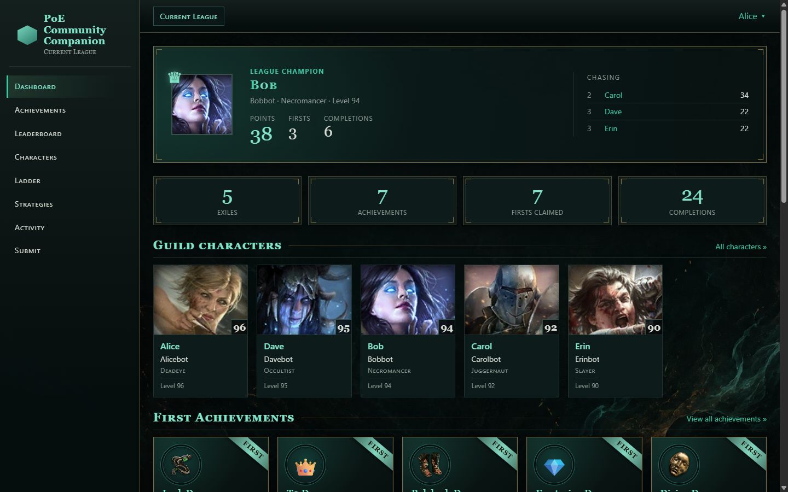
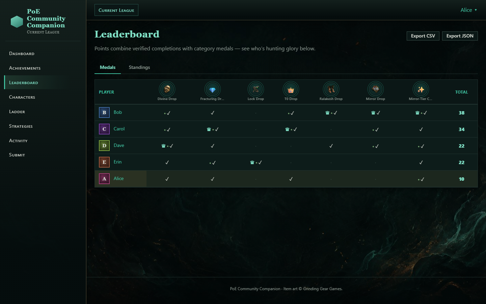
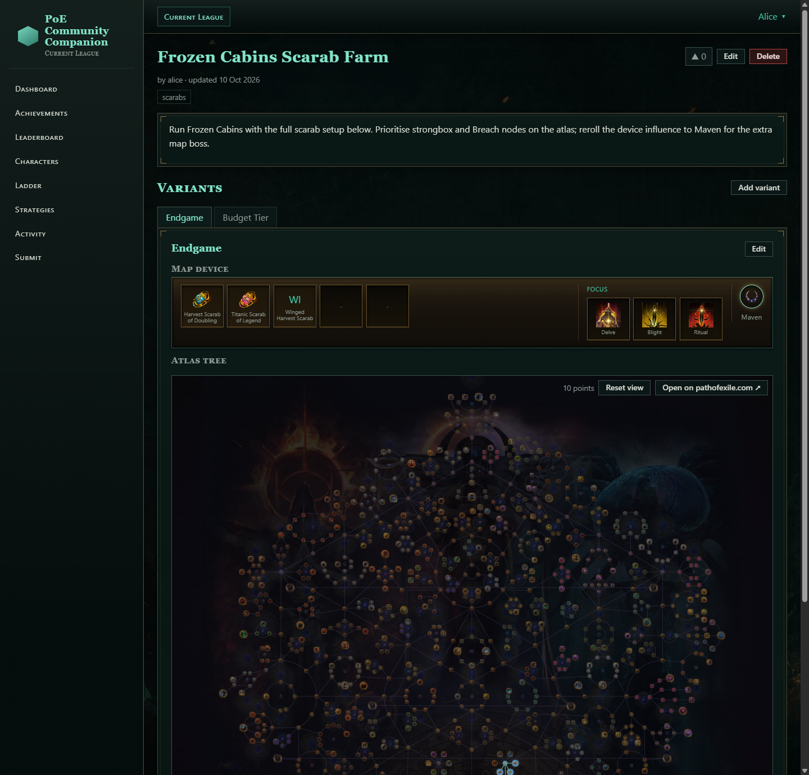
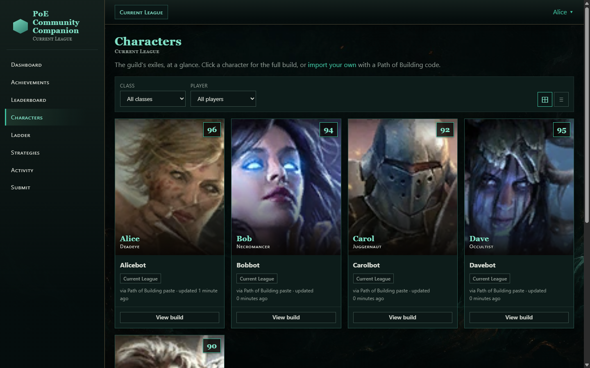
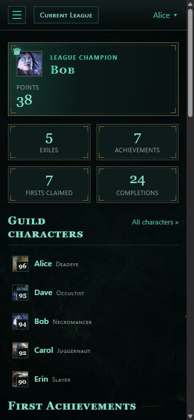

# PoE Community Companion

[](https://github.com/jcuzzz/poe-community-companion/actions/workflows/ci.yml)

A self-hosted Path of Exile guild / community companion. Members log
screenshot-backed claims for league achievements, which count immediately (staff can
moderate after the fact and members can vote on contested claims), and the site
ranks everyone by who got there first and who got there most efficiently. It also
tracks ladder characters and hosts a farming-strategy library with an interactive
atlas passive tree editor.

## Screenshots



| Leaderboard | Farming strategy with atlas tree |
|---|---|
|  |  |

| Characters | Mobile |
|---|---|
|  |  |

_Screenshots use the `seed_demo` dataset._

## Features

- **Achievements** with screenshot proofs, post-hoc staff moderation, contested-claim votes,
  comments and reactions, and a medal-based leaderboard (see [Scoring](#scoring)).
- **Leagues / seasons** with per-league achievements, read-only archives, and PoE 1 /
  PoE 2 support.
- **Roster and characters:** member profiles, Path of Building paste, ladder-based
  character tracking, optional PoE OAuth.
- **Farming strategies:** shareable strategies with scarab / map-device setups, live
  poe.ninja pricing, and an atlas passive tree viewer/editor.
- **Extras:** invite-only onboarding, configurable dashboard, share-card images,
  CSV/JSON export, optional Discord webhook.

Full inventory: [docs/FEATURES.md](docs/FEATURES.md).

## Engineering highlights

- **Derived-state scoring engine.** Awards are never edited; `scoring.recalculate()`
  rebuilds them from approved submissions inside a single transaction, with tie
  handling for shared bonuses.
- **Data modelling.** Partial unique constraints (one active league, one default
  character per player), composite indexes, and an append-only audit log of every
  state change.
- **External APIs with graceful degradation.** GGG OAuth (authorisation code + PKCE),
  the public ladder and league APIs, and poe.ninja pricing, all cached and rate-limit
  aware; when an upstream is down the feature falls back to cached data or quietly
  disappears.
- **Server-rendered SVG atlas passive-tree editor.** Shortest-path allocation and
  orphan pruning, server-side validation of every save, and import/export of
  pathofexile.com and poeplanner links.
- **Container-query dashboard** with a drag-and-drop layout builder; widgets pick
  their presentation from their own width, not the viewport.
- **460+ tests**, plus ruff and mypy (django-stubs), run in CI; query-count tests
  guard the dashboard against N+1 regressions.

## Stack

Django 6.0 · SQLite (WAL) · HTMX (progressive enhancement only) · local media storage ·
gunicorn + whitenoise · Docker Compose. No CSS framework, no JS build step; HTMX is
vendored. Item and atlas icons are hotlinked from GGG's CDN.

## Quick start

### Docker Compose

```bash
git clone https://github.com/jcuzzz/poe-community-companion.git
cd poe-community-companion
cp .env.example .env        # set DJANGO_SECRET_KEY, hosts, etc.
mkdir -p data media backups
docker compose up -d --build
docker compose exec web python manage.py seed_achievements
docker compose exec web python manage.py seed_players --admin leagueadmin
```

`seed_players` prints generated passwords **once** and never writes them to disk. For
real use put a TLS-terminating reverse proxy in front; see [docs/DEPLOY.md](docs/DEPLOY.md).

### Local development

```bash
python -m venv .venv
```

Install dependencies:

```bash
# POSIX
.venv/bin/pip install -r requirements.txt
# Windows
.venv\Scripts\pip install -r requirements.txt
```

Set up and run (from the repo root):

```bash
# POSIX
cd app
export DJANGO_DEBUG=1
../.venv/bin/python manage.py migrate
../.venv/bin/python manage.py seed_achievements
../.venv/bin/python manage.py seed_players --admin leagueadmin
../.venv/bin/python manage.py runserver
```

```powershell
# Windows (PowerShell)
cd app
$env:DJANGO_DEBUG = "1"
..\.venv\Scripts\python manage.py migrate
..\.venv\Scripts\python manage.py seed_achievements
..\.venv\Scripts\python manage.py seed_players --admin leagueadmin
..\.venv\Scripts\python manage.py runserver
```

## Configuration

Everything is environment-driven. Copy [`.env.example`](.env.example) to `.env`; each
variable is documented inline. The Django admin is **not** at `/admin/`; it is mounted
at `DJANGO_ADMIN_PATH` (change the default before going live).

## Running tests

```bash
# POSIX
cd app && DJANGO_DEBUG=1 ../.venv/bin/python manage.py test
```

```powershell
# Windows (PowerShell)
cd app; $env:DJANGO_DEBUG = "1"; ..\.venv\Scripts\python manage.py test
```

## Scoring

Per achievement:

| Result | Points |
|---|---|
| Verified completion | 2 (per-achievement `base_points`) |
| First verified submission | +5 |
| Lowest `/played` | +3 |
| Fewest `/kills` | +2 |
| Lowest character level | +1 |

Only **approved** submissions score, and only a player's earliest approved submission
per achievement. "First" is decided by the claimed `obtained_at`, with the
server-generated `submitted_at` shown alongside so contested claims are visible.
Ties share the bonus.

`Award` rows are derived state: `scoring.recalculate()` deletes and rebuilds them from
the approved submissions. Never edit them by hand; run
`manage.py recalculate_scores` instead.

## Security posture

Registration is closed; accounts are created by an admin or redeemed through a
single-use invite code. Failed logins lock out per username + IP (django-axes) and
invite redemption is rate limited. By default every page except `/healthz` requires a login;
set `PUBLIC_READ=1` to let anyone browse read-only pages (dashboard, leaderboard,
characters, strategies, proof images) while submitting, voting, commenting and
editing still need an account. Uploads are
capped at 10 MB, restricted to JPEG/PNG/WebP by decoding the file rather than trusting
its extension (the stored extension comes from the detected format), and re-encoded to
strip EXIF. The Django admin account is kept separate
from player accounts.

To report a vulnerability, see
[SECURITY.md](SECURITY.md).

## Project layout

```
poe-community-companion/
├── app/                      Django project
│   ├── config/               settings, root urls, wsgi
│   ├── tracker/              achievements, scoring, leagues, roster, ladder
│   │   ├── models.py         User, Character, Achievement, Submission, ProofImage, Award, ...
│   │   ├── scoring.py        scoring engine; Awards are derived, never hand-edited
│   │   └── management/commands/   seed_*, make_invite, recalculate_scores, backup, ...
│   ├── strategies/           farming strategies, scarab picker, atlas tree, poe.ninja pricing
│   ├── static/               CSS, JS (vendored htmx), images
│   ├── data/                 db.sqlite3      (volume, gitignored)
│   └── media/                proofs/         (volume, gitignored)
├── deploy/                   Caddy snippet, backup/poll/pricing scripts, systemd units
├── docs/                     features, roadmap, deploy guide, design notes
├── scripts/                  atlas / scarab data builders
├── Dockerfile compose.yml entrypoint.sh .env.example
└── backups/                  db + media pairs (gitignored)
```

## Documentation

- [docs/FEATURES.md](docs/FEATURES.md): what the app does today
- [docs/ROADMAP.md](docs/ROADMAP.md): where it is going
- [docs/DEPLOY.md](docs/DEPLOY.md): self-hosting, backups, updates, restore
- [docs/view-contract.md](docs/view-contract.md): view / template contract
- [docs/design/](docs/design/), [docs/specs/](docs/specs/), [docs/research/](docs/research/): design notes
- [CONTRIBUTING.md](CONTRIBUTING.md) · [SECURITY.md](SECURITY.md)

## License

[MIT](LICENSE). Bundled class portraits are third-party art with their own terms; see
[docs/ART-CREDITS.md](docs/ART-CREDITS.md).

## Disclaimer

This product isn't affiliated with or endorsed by Grinding Gear Games in any way.
Path of Exile and its artwork are property of Grinding Gear Games; art credits are in
[docs/ART-CREDITS.md](docs/ART-CREDITS.md).
